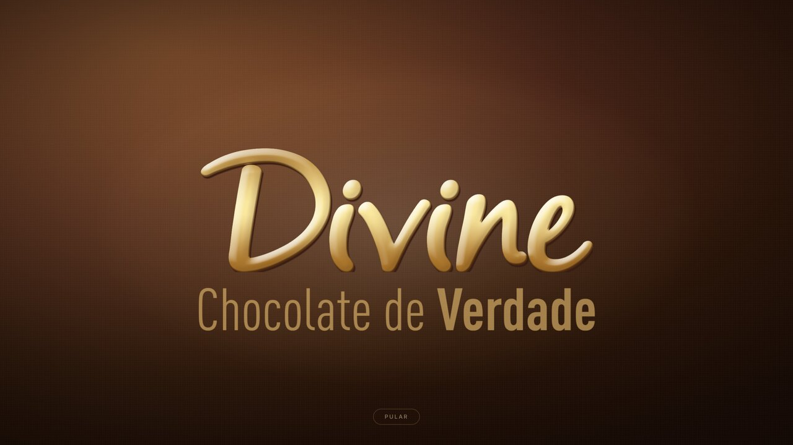
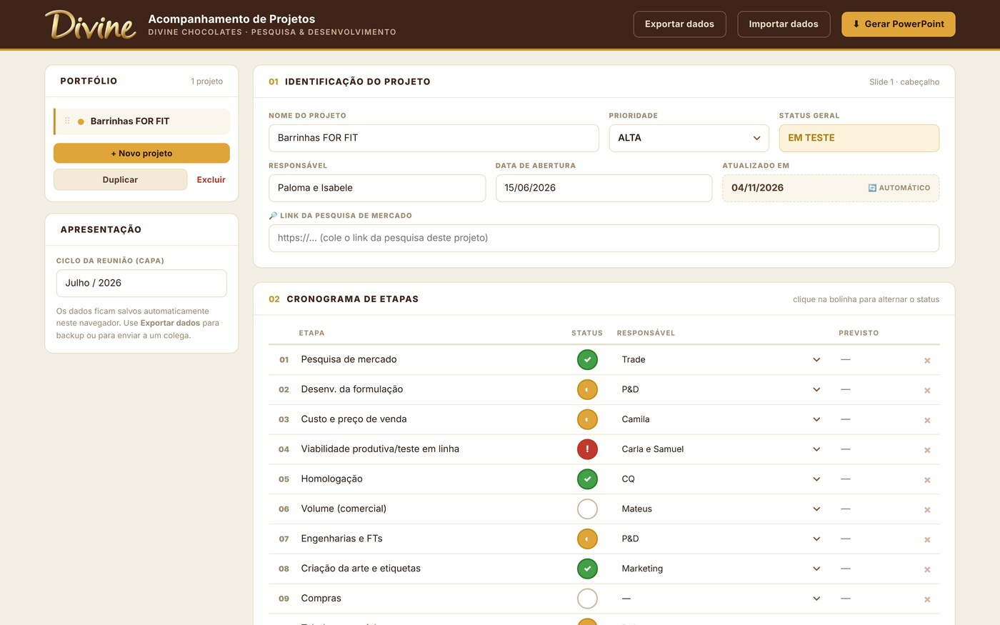
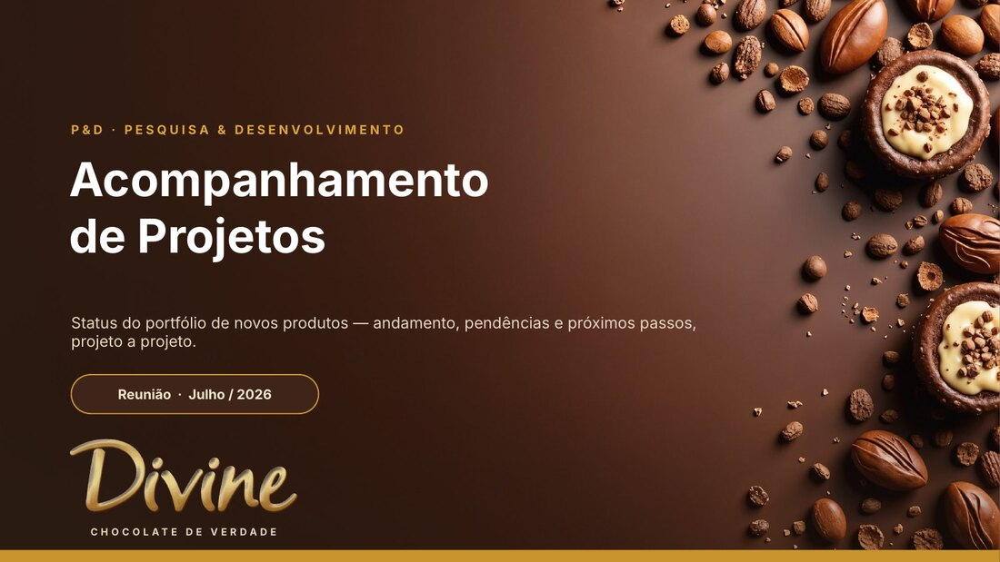
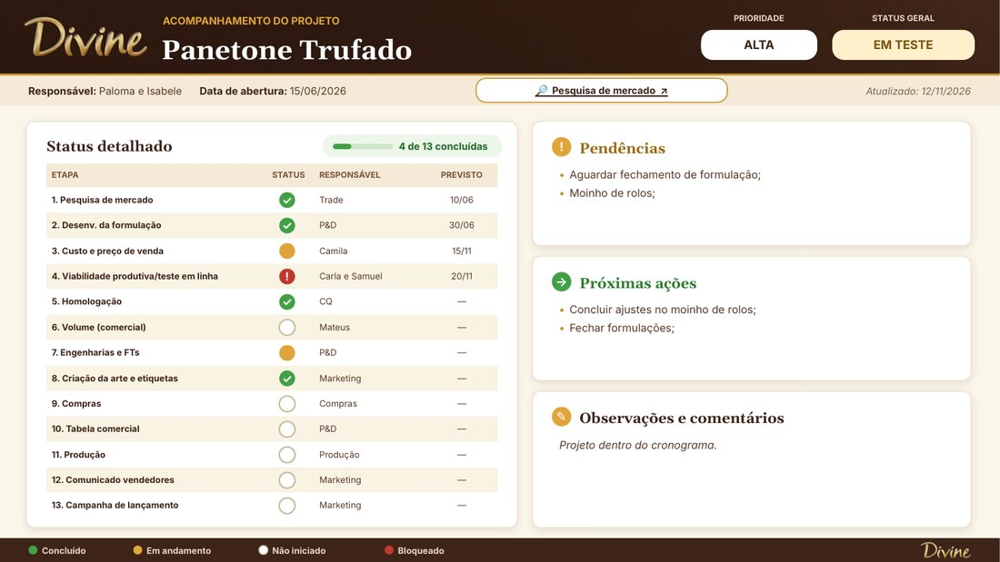
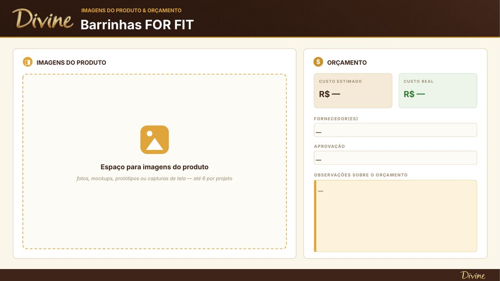

<div align="center">



# 🍫 Divine P&D · Acompanhamento de Projetos

**Editor web que organiza o portfólio de novos produtos da Divine Chocolates
e gera, com um clique, a apresentação em PowerPoint da reunião de P&D.**

[](https://oleodias.github.io/divine-example/)
[](../../releases)


</div>

---

## ✨ Sobre o projeto

Antes, cada reunião de acompanhamento exigia montar slides à mão, projeto por projeto.
Agora a equipe de **Pesquisa & Desenvolvimento** preenche um formulário simples no
navegador, e o editor gera uma **apresentação com a identidade visual da Divine**,
com capa, slides por projeto, galeria de fotos, orçamento e animações.

Tudo fica em **um único arquivo HTML**. Não precisa de instalação, servidor nem login,
e funciona até offline.

<div align="center">

<br><sub><i>Editor: portfólio à esquerda e formulário do projeto à direita</i></sub>
</div>

---

## 🚀 Funcionalidades

| | Recurso | Detalhes |
|---|---|---|
| 📋 | **Portfólio de projetos** | Crie, duplique, exclua e **reordene arrastando**. A numeração é automática. |
| 🗂️ | **Portfólio por status** | Projetos separados em **Em andamento** (ordenados por prioridade), **Pausados**, **Finalizados** e **Cancelados**, em grupos recolhíveis. Nada é apagado: basta mudar o *Status geral*. |
| 🗓️ | **Cronograma de etapas** | Etapas com responsável e prazo. Clique na bolinha para alternar o status. |
| 🚦 | **Status visual** | ✓ Concluído · ◐ Em andamento · ! Bloqueado · ○ Não iniciado |
| 👥 | **Responsáveis** | Lista com as áreas (P&D, Compras, Marketing, Trade, Produção…) e os nomes já usados. |
| 📅 | **Datas automáticas** | Máscara `dd/mm/aaaa` na abertura e "Atualizado em" preenchido sozinho. |
| 📝 | **Pendências e próximas ações** | Uma por linha, já formatadas em tópicos no slide. |
| 💰 | **Orçamento** | Custo estimado × real, fornecedores, aprovação e observações. |
| 🖼️ | **Galeria de fotos** | Layout justificado que **respeita a proporção** de cada imagem, sem distorcer. |
| 🔎 | **Pesquisa de mercado** | Link clicável direto no slide do projeto. |
| ⬇️ | **Gerar PowerPoint** | `.pptx` nativo, editável, com transições *fade* e entradas em cascata. Slides completos só dos projetos em andamento, mais um **resumo** dos pausados, finalizados e cancelados. |
| ☁️ | **Nuvem da equipe** | Login com e-mail e senha; o portfólio é compartilhado e salvo automaticamente no Supabase, com aviso de edição simultânea e lixeira. |
| 🧾 | **Histórico auditável** | Quem fez o quê e quando, com o "de → para" de cada campo, gravado pelo servidor e imutável. Motivo obrigatório ao pausar ou cancelar. |
| 💾 | **Funciona offline** | Cópia local sempre salva; sincroniza ao reconectar. Modo "só neste computador" e **Exportar/Importar dados** (JSON) como backup. |
| ✨ | **Animação de entrada** | A caligrafia "Divine" desenhada em dourado a cada acesso, com botão **Pular**. |
| 📈 | **Progresso das etapas** | Barra em cada projeto da lista e selo **"X de Y concluídas"** no editor e no slide. |
| ↩️ | **Desfazer** | Removeu uma etapa, foto ou projeto sem querer? O aviso traz o botão **Desfazer**. |
| ✅ | **Validação de datas** | Datas impossíveis (ex.: 31/02) são sinalizadas logo abaixo do campo. |
| ♿ | **Acessível** | Contraste adequado, navegação por teclado (Tab, Enter, Alt+↑/↓ nas etapas) e foco visível. |
| 🎨 | **Visual Divine** | Títulos em Fraunces, textos em Inter (embutidas, funcionam offline) e selects no estilo da marca. |

---

## 🎞️ A apresentação gerada

<table>
<tr>
<td width="50%"><br><sub><b>Capa:</b> ciclo da reunião e foto da marca</sub></td>
<td width="50%"><br><sub><b>Projeto:</b> cronograma, pendências e próximas ações</sub></td>
</tr>
<tr>
<td width="50%"><br><sub><b>Imagens e orçamento</b> do produto</sub></td>
<td width="50%"><br><sub><b>Resumo:</b> pausados, finalizados e cancelados</sub></td>
</tr>
</table>

---

## 🧭 Como usar

1. Acesse **[oleodias.github.io/divine-example](https://oleodias.github.io/divine-example/)** e entre com o seu
   e-mail e senha (o administrador cria os acessos).
2. Escolha um projeto no **Portfólio** (ou clique em **+ Novo projeto**).
3. Preencha identificação, etapas, pendências, fotos e orçamento.
4. Informe o **Ciclo da reunião** (ex.: *Julho / 2026*), que vai para a capa.
5. Clique em **⬇ Gerar PowerPoint** e pronto!

> 💡 **Dica:** tudo é salvo sozinho na nuvem — o topo mostra **"Salvo na nuvem"**. Sem internet, o editor
> continua funcionando e envia as alterações quando a conexão voltar. **Exportar dados** segue disponível como backup.

---

## 🗂️ Estrutura do repositório

```
├── index.html                  ← o editor publicado (GitHub Pages)
├── editor/
│   ├── editor_src.html         ← código-fonte da interface
│   ├── build_editor.js         ← monta o arquivo único Editor_Divine.html
│   ├── divine_export.js        ← gera os slides (layout, galeria, orçamento)
│   ├── divine_anim.js          ← transições e animações do PowerPoint
│   ├── divine-intro.js         ← animação de entrada da página
│   ├── divine_logo.js / divine_capa.js / divine_intro_assets.js  ← imagens embutidas
│   ├── processa_logo.py / processa_capa.py / processa_intro.py   ← preparam as imagens
│   ├── divine_nuvem.js         ← login, sincronização com o Supabase, lixeira e histórico
│   └── migra_dados.py          ← converte backups antigos para o formato atual
├── supabase/schema.sql         ← banco: tabelas, regras de segurança e auditoria (rodar no SQL Editor)
├── apresentacao/               ← modelo estático em Python (python-pptx)
├── assets/                     ← arquivos originais da marca (logo, capa, caligrafia)
└── docs/img/                   ← imagens deste README
```

---

## 🛠️ Para desenvolvedores

O editor é escrito em `editor/editor_src.html` e "empacotado" num único HTML,
com bibliotecas, logo e animações embutidas:

```bash
cd editor
npm ci          # instala as versões fixadas no package-lock.json
npm run build   # gera Editor_Divine.html e atualiza o ../index.html
```

Ao publicar na `main`, o **GitHub Pages** atualiza o site automaticamente.
As mudanças entram por *Pull Request* e cada versão estável recebe uma *tag*
(ex.: [`v1.0-estavel`](../../releases)).

---

## 👨‍💻 Desenvolvedor

<div align="center">

<table>
<tr>
<td align="center" width="420">
<br>
<h3>Leonardo Dias</h3>
<sub>IDEALIZAÇÃO E DESENVOLVIMENTO</sub>
<br><br>
<a href="https://github.com/oleodias"></a>
<br><br>
</td>
</tr>
</table>

Projeto desenvolvido para a área de **Pesquisa & Desenvolvimento** da **Divine Chocolates**.

<br>
<sub>© 2026 Leonardo Dias</sub>

</div>
